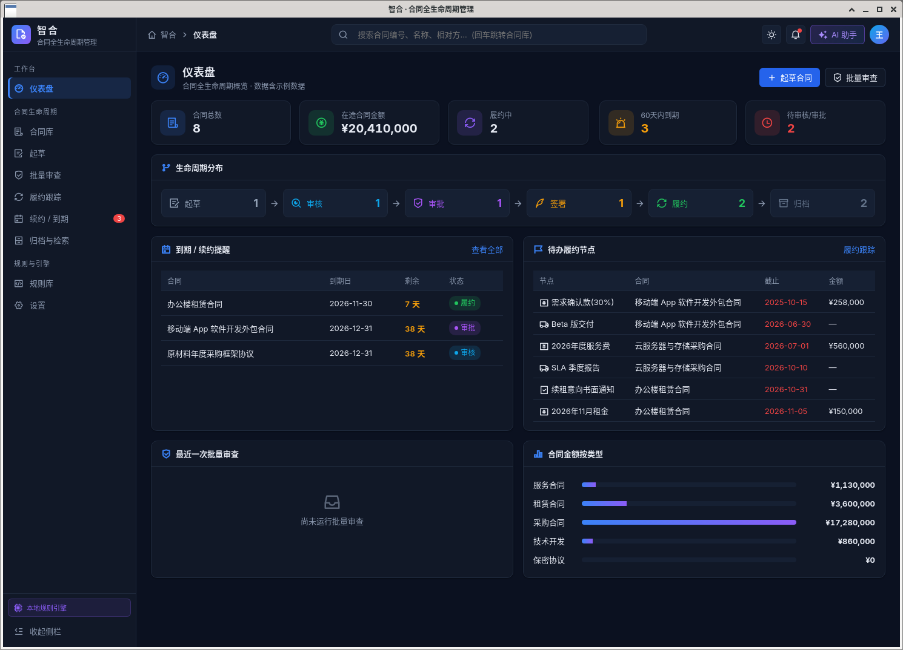
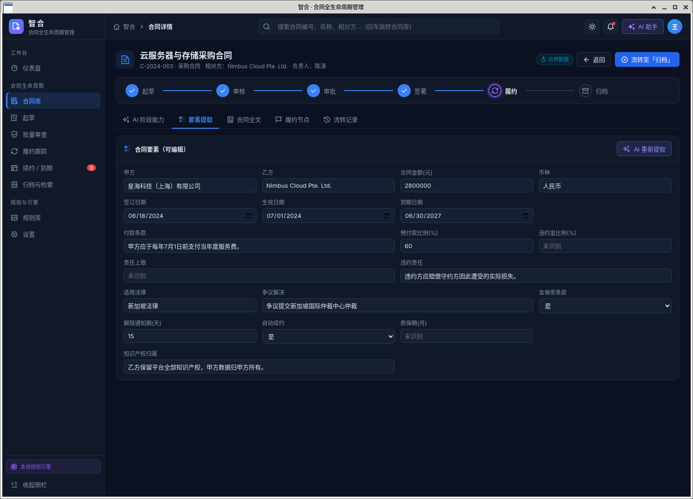
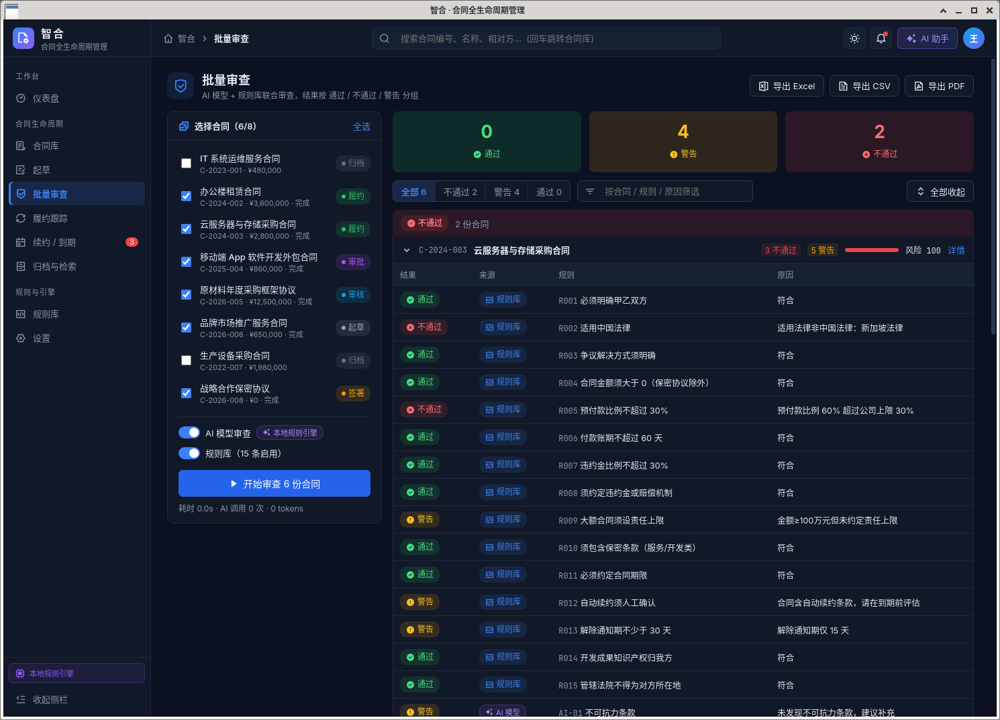

# 智合 Zhihe

**1.1.0** · 合同全生命周期管理（CLM）桌面应用：起草、要素提取、审核、审批、签署、履约、归档与续约，并可接入本地或远程 AI 引擎。

## 下载

当前 GitHub 上**没有**已发布安装包（无 Release）。`package.json` 版本为 **1.1.0**。Windows 打包可用 `npm run dist:win`，按 `electron-builder.yml` 预期产物为 `release/Zhihe-1.1.0-Setup.exe`。本轮因磁盘不足未打包上传。

## 界面截图

以下三张是在 Linux 箱子上启动 **智合 Zhihe 1.1.0** 后截取的真实产品窗口。画面使用应用内置的示例合同（带「示例数据」标记），未打开设置页，无 API Key，也没有真实敏感合同。







## 功能特性

- 覆盖合同全流程阶段，每个阶段可单独指定 AI 引擎；远程失败可回退本地规则引擎。
- 引擎：本地规则（离线）、Ollama、OpenAI 兼容接口，以及 JEV · TypeSafe 决策接口。
- 支持大型 PDF / DOCX（分块解析、可取消、虚拟滚动、map-reduce 抽取与审查）。
- API Key 只保存在用户数据目录，源码中不含密钥。

## 技术栈

- Electron + electron-vite + React + TypeScript
- mammoth / pdf-parse 等文档解析

## 从源码运行

源码在仓库根目录。本仓库目前不提供已发布安装包。需要安装包时在可构建环境执行 `npm run dist:win`（本轮未执行）。

```bash
npm install
npm run dev
npm run build
```
测试相关命令。；测试 Key 只通过环境变量传入。

## 文档

## 贡献

欢迎通过 Issue 和 Pull Request 参与，详见 [CONTRIBUTING.md](CONTRIBUTING.md)。安全问题请按 [SECURITY.md](SECURITY.md) 私下报告。参与时请遵守 [CODE_OF_CONDUCT.md](CODE_OF_CONDUCT.md)。

## 许可证

本仓库尚未附带 LICENSE 文件，许可证未指定。

---

## English

# Zhihe

**1.1.0** · A contract-lifecycle management (CLM) desktop app: draft, extract, review, approve, sign, perform, archive, and renew — with local or remote AI engines at each stage.

### Download

No published installer on GitHub Releases. Version **1.1.0**. Package with `npm run dist:win`; expected artifact `release/Zhihe-1.1.0-Setup.exe`. This pass did not build or upload packages (disk).

### Screenshots

These three images are real product-window captures of **Zhihe 1.1.0** running on Linux. The session used the app’s built-in sample contracts (tagged as sample/demo data). Settings was not opened, so no API keys are visible, and no real confidential contracts are shown.


## Features

- Covers the full contract lifecycle; each stage can use a different AI engine, with fallback to the local rules engine.
- Engines: offline local rules, Ollama, OpenAI-compatible APIs, and the JEV · TypeSafe decision API.
- Handles large PDF / DOCX files (chunked parsing, cancellation, virtual scrolling, map-reduce extract and review).
- API keys are stored only in the user data directory and are not in the source tree.

## Tech stack

- Electron + electron-vite + React + TypeScript
- mammoth / pdf-parse 等文档解析

## Getting started

Source is at the repository root. There is no published installer. To package on a build machine, run `npm run dist:win` (not run in this pass).

```bash
npm install
npm run dev
npm run build
```
Test commands are in `README.original.md`. Test keys must be passed via environment variables only.

## Documentation

## Contributing

Issues and pull requests are welcome. See [CONTRIBUTING.md](CONTRIBUTING.md). Please report vulnerabilities privately via [SECURITY.md](SECURITY.md). This project follows [CODE_OF_CONDUCT.md](CODE_OF_CONDUCT.md).

## License

No LICENSE file is included in this repository; the license is unspecified.
